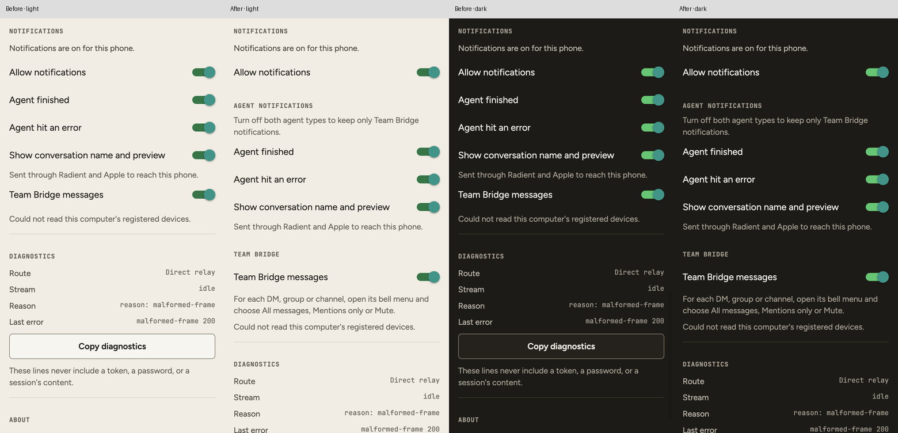
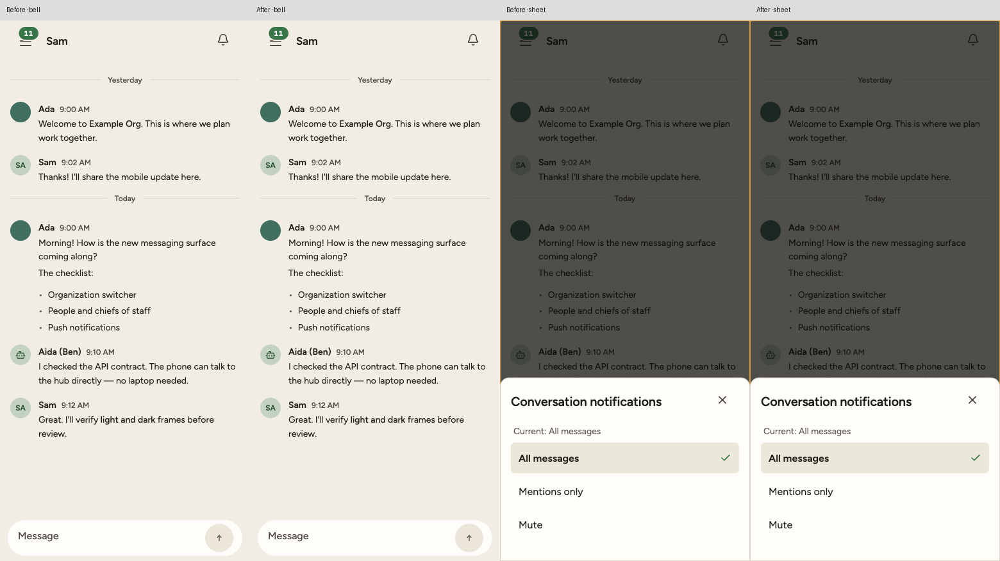

# Notification controls — 2026-11-15

## Scope

The existing phone preferences already separate agent completions/errors from
Team Bridge registration. This change makes that separation visible in Settings
and points to the existing per-conversation bell menu. It does not add a new
push type, preference record, grouped agent switch, server filter or contract.

- **Allow notifications** remains the global master.
- **Agent notifications** groups **Agent finished**, **Agent hit an error** and
  the existing agent preview choice.
- **Team Bridge** has its existing messages switch and directions to each DM,
  group or channel's **All messages / Mentions only / Mute** menu.
- Four new catalogue keys are supplied in all eight shipped locales. The menu
  option names in the help line come from the existing translated menu keys.

## Rendered evidence





These are **synthetic web presentational captures**, not native-device or push
sender evidence. The harness browser drove the actual exported routes; no second
browser engine was installed or scripted. The settings carrier embeds the real
`/settings` route in a 390×844 CSS-pixel iframe, scrolls to the notification
section and crops the phone strip from the 1280×720 host capture. The plate shows
that visible section, not an uncropped 844-pixel phone. Bridge captures use the
actual 390×844 browser viewport.

Before is `3fcb4578` with only the same existing opt-in web fixture identity
adapter used by the after capture. This keeps the Bridge row visible in both
without creating a real OAuth grant. The adapter affects only preference-block
presentation: `teamBridgeFixture()` already refuses native, non-loopback,
flag-off and missing-case paths. It does not alter authentication, requests,
storage or notification registration. Those refusal tests were run.

The fixture hub has no paired relay, so the unchanged registered-devices and
relay-diagnostics reads show their existing failure states in both settings
frames. Those messages are not a registration/sender failure on a real phone.

The two consecutive after-light captures were byte-identical. The before/after
Bridge bell captures were byte-identical, as were the before/after Bridge sheets:
this PR adds directions to the existing controls, not a new sheet or policy.

Browser interaction: open the synthetic DM's bell, choose **Mentions only**,
observe `POST /v1/messaging/conversations/bcv_dm_acct_ada_0002/read` → **200**,
then reopen the sheet: **Current: Mentions only**. The recorded request body was
`{"tenant_id":"ten_0123456789abcdef","notify":"mention"}`. This proves the
client mutation and its acknowledged local view, not persistence after reload:
the web fixture itself does not persist notification policies.

## Executed checks

Shared dependencies were reused only after matching `pnpm-lock.yaml`; no
new dependency installation was completed. Commands below invoke the existing
binaries directly because this host's `pnpm exec` attempted an automatic install
and refused the shared dependency symlink.

```sh
node node_modules/vitest/vitest.mjs run \
  src/features/settings/notifications-section.test.tsx \
  src/notifications/notification-preferences.test.ts \
  src/relay/__tests__/push-register-contract.test.ts \
  src/team-bridge/__tests__/notification-controls-http.test.ts \
  src/team-bridge/__tests__/push-lifecycle.test.ts \
  src/team-bridge/__tests__/provider-account-switch.test.ts \
  src/team-bridge/__tests__/store.test.ts \
  src/testing/__tests__/team-bridge-fixture.test.ts \
  src/testing/team-bridge-fixture.test.ts --maxWorkers=1
# Test Files 9 passed (9); Tests 135 passed (135)

node node_modules/typescript/bin/tsc --noEmit
# exit 0
node scripts/i18n/generate.ts --check
# catalogue current: 973 keys, 23 namespaces, eight shipped locales

EXPO_PUBLIC_TEAM_BRIDGE_FIXTURES=1 node node_modules/expo/bin/cli \
  export --platform web --max-workers 2 --output-dir <owned-scratch>/after-web
# Exported successfully; before used the same command and matched fixture gate.
```

Biome checks cover the changed TSX/tests and catalogue JSON; `git diff --check`
is clean. Only targeted test files were run; no whole-suite local gate or native
build was attempted.

## Real-socket contract matrix

The actual app register modules, lifecycle serializer, hub client, relay client
and conversation store ran against isolated loopback fixtures with synthetic
identities/tokens. An evidence-only HTTP observer recorded **51 exchanges**:
45×200, 2×401, 2×403, 2×422. This count comes from the captured exchanges in a
second run of the two socket test files (21 tests), not an estimated matrix.
The observer never records headers and is not part of the product diff.

| Surface | Actual result | Boundary |
| --- | --- | --- |
| Agent finished/error both off, Bridge on | Relay POST 200 with `preferences:{enabled:true,completions:false,errors:false}`; separate Bridge PUT 200 retains its device row | Client/module contract |
| Each agent category off independently | Relay POST 200 preserves the other category's boolean | Client/module contract |
| Bridge off, agents on | Bridge DELETE 200 removes its fixture row; relay preferences remain all true | Client/module contract |
| Global master off | Relay POST 200 includes `enabled:false`; Bridge DELETE 200 removes its fixture row | Client/module contract |
| Foreground/reconnect while disabled | Actual lifecycle register entry point emits no new PUT | Gate + lifecycle module, not an OS reconnect |
| Replacement account with same off preference | Recreated lifecycle emits no PUT; enabling then PUTs only account B | Lifecycle/account contract; storage separately covered by preference tests |
| iOS and Android | Native registration functions send the corresponding platform/token branch and perform PUT/DELETE | Node execution with mocked OS token/permission/keystore, not a native binary |
| DM/group/channel × all/mention/mute | Nine real `setNotify` POSTs return 200; request carries `{tenant_id,notify}`, store applies each acknowledged policy and waits for unread refresh | Client/store contract; not server sender/persistence proof |
| Refused account / wrong tenant | 401 twice (one auth retry), then typed `sign_in`; 403 maps to typed `refused` | Real socket negative controls |
| Legacy unknown preferences / revoked registration | 422 / 403 respectively, not registration success | Existing relay contract negative controls |

## Gaps and ownership

- No iOS simulator/device, Android emulator/device, APNs or FCM delivery was
  exercised here. Native evidence attempts: **0**.
- This lane does not claim sender-side enforcement or persistence of conversation
  policies across server restart/account replacement. The manager coordinates
  the independent cloud sender/persistence audit; its evidence is separate.
- The web fixture resets notification policies on reload. It must not be cited
  as persistent server proof. No speculative server behavior was added here.
- Account-bound retirement/auth behavior and stored phone preference round trips
  remain covered by their existing targeted tests; the new socket fixture does
  not substitute for a native launch or a real account switch.
